<p align="center">
  
</p>

<div align="center">

<table>
<tr>
<td align="center" width="33%"><br><b>Sooyeon Cho</b><br>Development</td>
<td align="center" width="33%"><br><b>Haejun Paik</b><br>Design</td>
<td align="center" width="33%"><br><b>Dahyun Lee</b><br>Biology</td>
</tr>
</table>

</div>

# KOOK — Kinetic Observation & Optimal Keel

**A health monitoring dashboard that helps astronauts manage their own health on long-duration space missions.**

NASA Space Apps Challenge · *Create Health Monitoring Software for Astronauts on Space Missions*
Team Kook · Sooyeon Cho, Haejun Paik, Dahyun Lee

<div align="center">

<table>
<tr>
<td align="center" width="33%"><a href="https://chosooy.github.io/nasa-hackathon/dashboard/">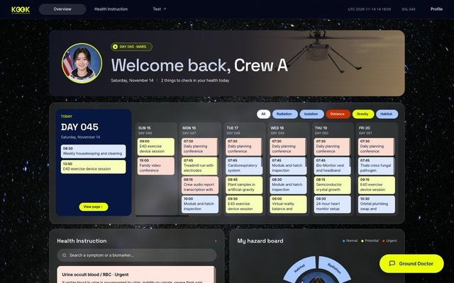</a><h3><a href="https://chosooy.github.io/nasa-hackathon/dashboard/">▶ Live dashboard</a></h3></td>
<td align="center" width="33%"><a href="https://chosooy.github.io/nasa-hackathon/test/">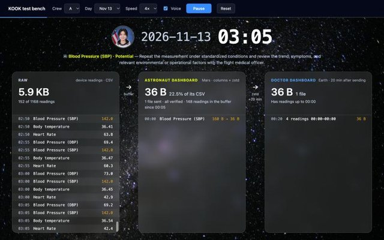</a><h3><a href="https://chosooy.github.io/nasa-hackathon/test/">▶ Test bench</a></h3></td>
<td align="center" width="33%"><a href="docs/project-demonstration.pdf">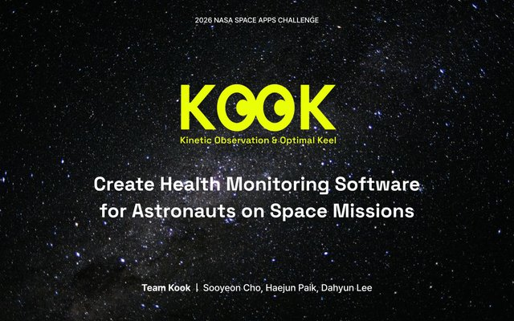</a><h3><a href="docs/project-demonstration.pdf">Slides (PDF)</a></h3></td>
</tr>
</table>

</div>

## Summary

KOOK (Kinetic Observation & Optimal Keel) is a health monitoring dashboard designed to help astronauts manage their health on their own during long-duration space missions.

On long missions, astronauts are exposed to the five major health hazards identified by NASA. These risks vary in severity, so astronauts need a system that lets them assess their health immediately and gives them step-by-step guidance.

KOOK aims to lower the barriers to health management in space with an intuitive, accessible dashboard that anyone can understand and use.

## Project demonstration

[Open the slides as a PDF](docs/project-demonstration.pdf). GitHub's PDF viewer scrolls through all 7 pages.

<details>
<summary><b>Show all slides here</b></summary>

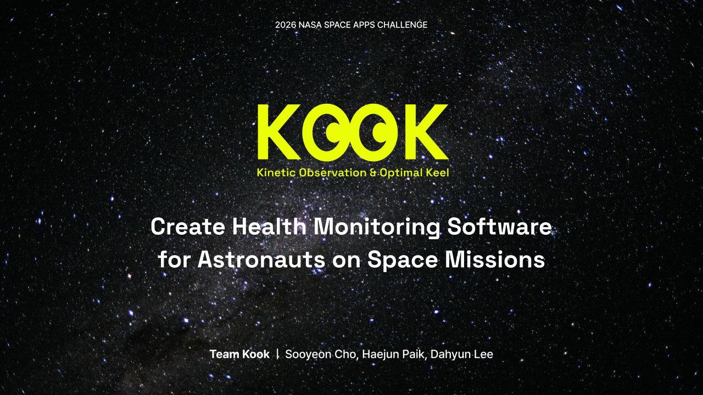
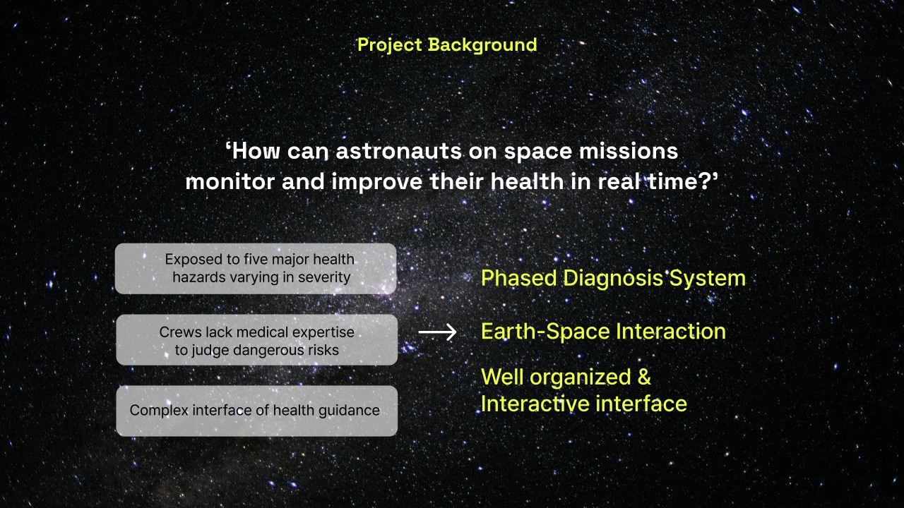
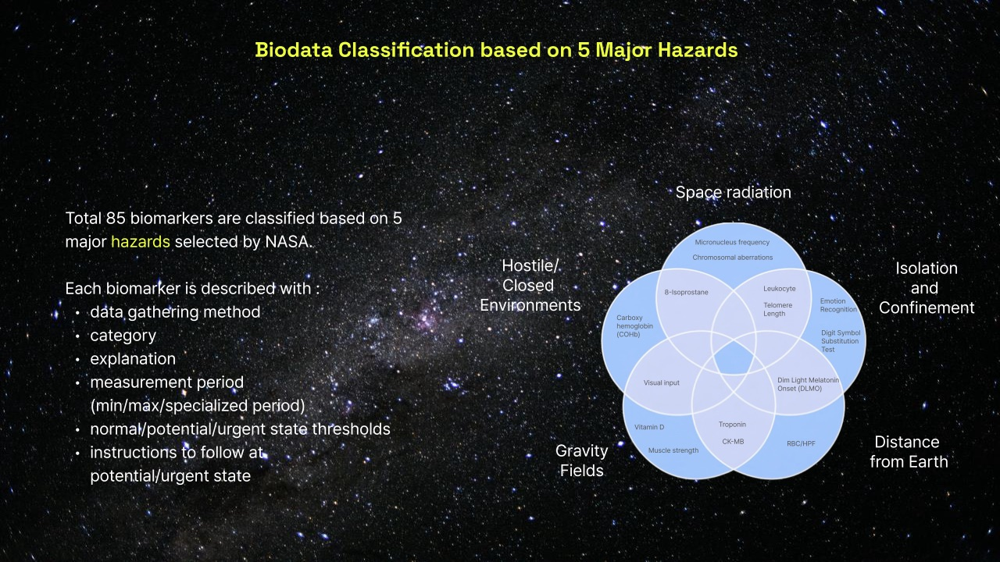
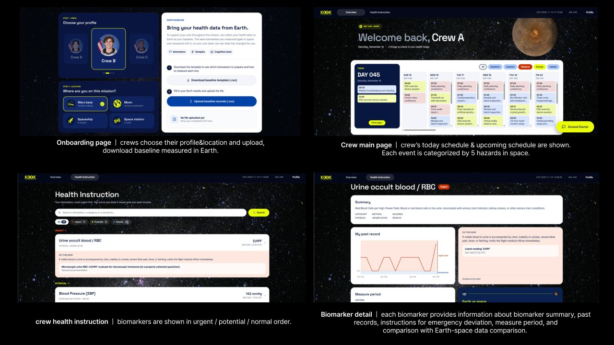
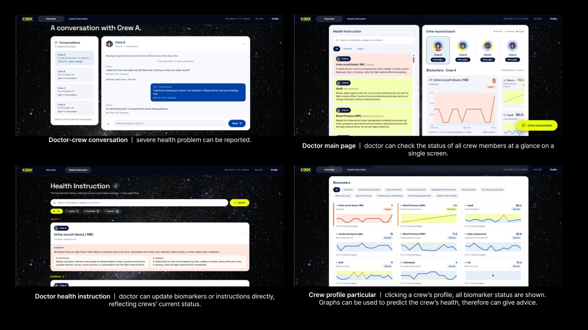
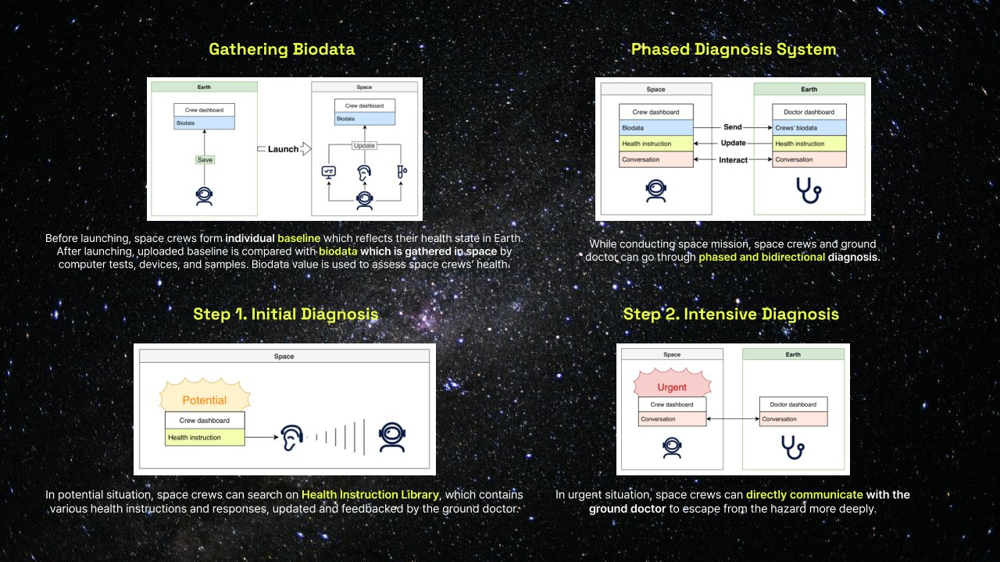
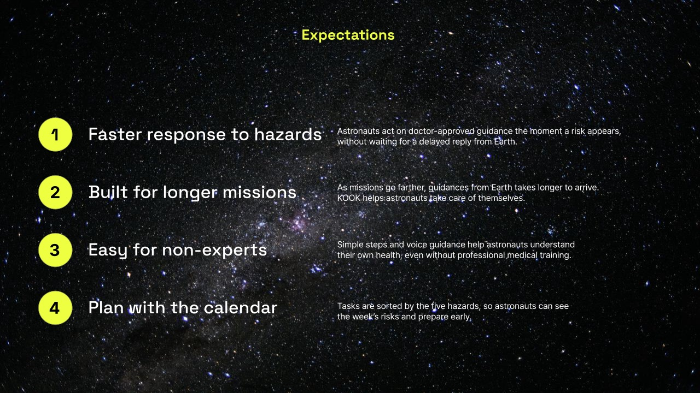

</details>

## Background

> *How can astronauts on space missions monitor and improve their health in real time?*

| Problem | Our answer |
| --- | --- |
| Crews face five major health hazards that vary in severity | **Phased diagnosis:** the response follows the severity, Potential or Urgent |
| Crews lack the medical expertise to judge dangerous risks | **Earth–space interaction:** guidance and conversation come from doctors on Earth |
| Health guidance comes with complex interfaces | **A well-organized, interactive interface** that anyone can read |

## Biodata classification

We classified **85 biomarkers** by NASA's five major hazards:

- Space radiation
- Isolation and confinement
- Distance from Earth
- Gravity fields
- Hostile and closed environments

Each biomarker is described with:

- its data-gathering method (device, sample or computer test) and category
- a short explanation
- its measurement period (minimum, maximum or a specific period)
- Normal / Potential / Urgent thresholds
- instructions to follow when it is Potential or Urgent

The demo dashboard uses 32 of these biomarkers for four crew members (`data/crew/`).

## How it works

### Gathering biodata

Before launch, each crew member records an individual **baseline** of their health on Earth. After launch, KOOK compares that baseline with the biodata gathered in space from **computer tests, devices and samples**. These values are used to assess each crew member's health.

### Phased diagnosis

KOOK sorts each biomarker into one of three severity levels: **Urgent**, **Potential** or **Normal**. Crews and the ground doctor go through diagnosis in phases, in both directions.

**Step 1 — Immediate response** (Potential)

- Astronauts open the **Health Instruction Library**. Its health guidelines and responses are uploaded and updated by medical professionals.
- A **linked audio device** reads the instructions aloud, so astronauts can follow the recommended steps without relying only on the screen.

**Step 2 — In-depth consultation** (Urgent, or whenever more help is needed)

- Astronauts talk directly with medical professionals on Earth in **one-on-one chat consultations**.
- They can report a serious health problem and get out of the hazard quickly.

### Earth–space interaction

| Crew dashboard (space) | | Doctor dashboard (Earth) |
| --- | :---: | --- |
| Biodata | **Send →** | Crews' biodata |
| Health instruction | **← Update** | Health instruction |
| Conversation | **← Interact →** | Conversation |

**Getting the data to Earth**

- The crew dashboard shows every reading right away.
- Readings go to the doctor's dashboard as small compressed files. A new Potential or Urgent reading is sent at once, and everything else at least every 6 hours.
- Each file arrives 20 minutes later, the one-way light delay. Chat has the same delay.
- See the [development document](docs/DEVELOPMENT.md#data-flow) for the details and the experiments behind it.

## Screens

<table>
<tr>
<td width="50%" valign="top">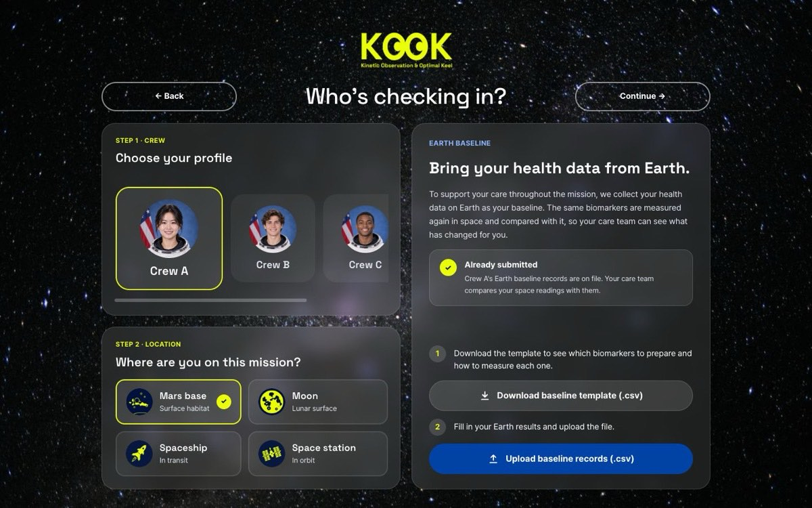<br><b>Onboarding</b><br>Choose a crew profile and location, then download and upload the baseline measured on Earth.</td>
<td width="50%" valign="top"><br><b>Crew · Main page</b><br>Today's schedule and upcoming events, each tagged with its space hazard, plus the hazard board.</td>
</tr>
<tr>
<td width="50%" valign="top">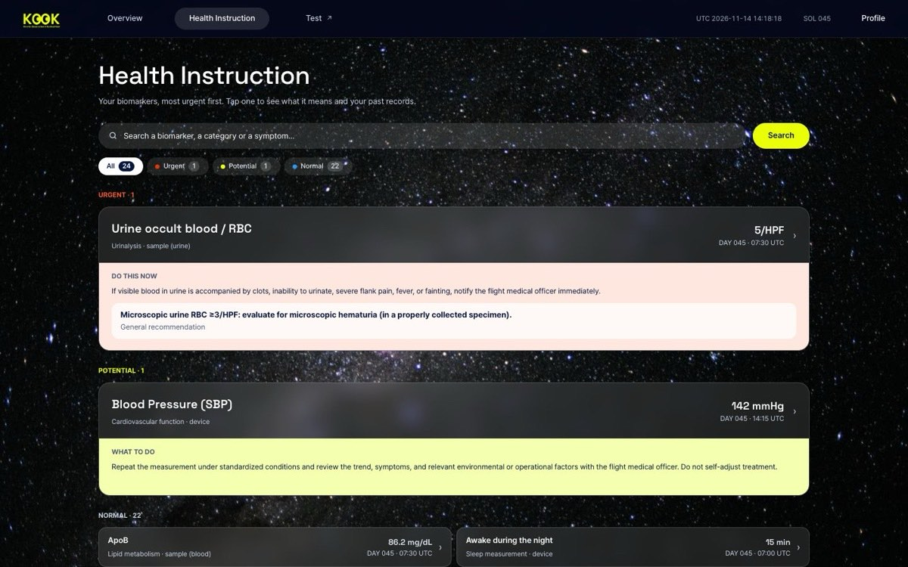<br><b>Crew · Health instruction</b><br>Biomarkers in Urgent → Potential → Normal order, each with what to do.</td>
<td width="50%" valign="top">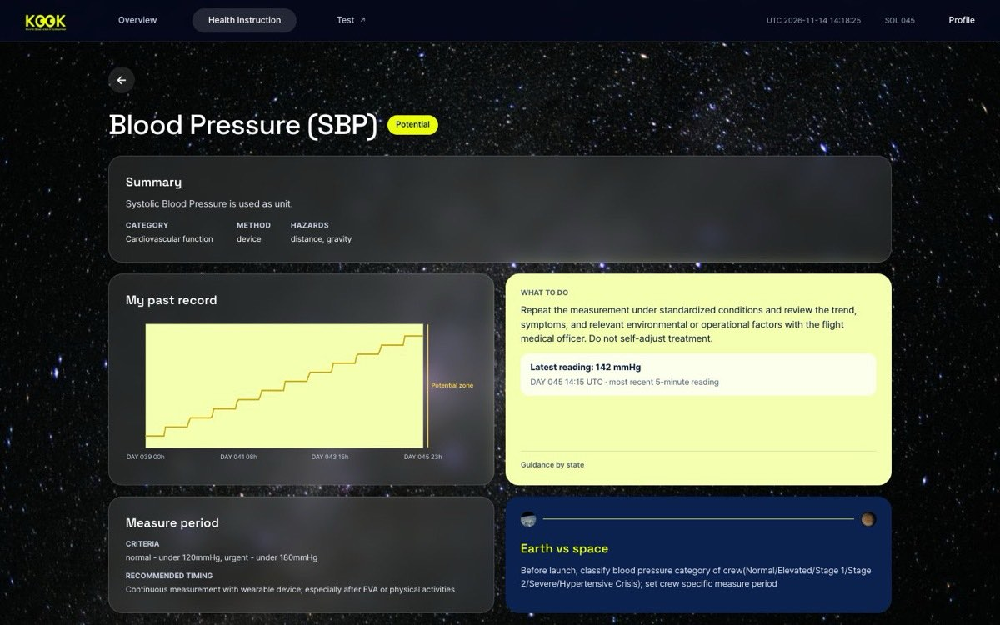<br><b>Crew · Biomarker detail</b><br>Summary, past records, what to do now, measurement period and the Earth–space comparison.</td>
</tr>
<tr>
<td width="50%" valign="top">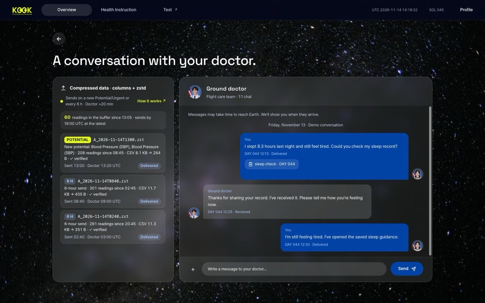<br><b>Crew · Conversation</b><br>One-on-one chat with the ground doctor, next to the log of compressed files sent to Earth.</td>
<td width="50%" valign="top">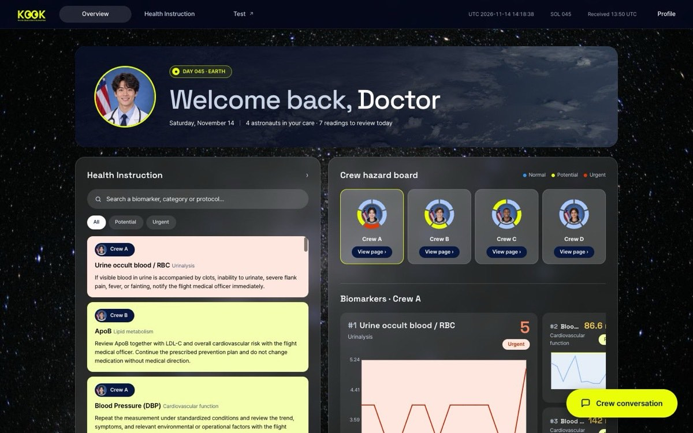<br><b>Doctor · Main page</b><br>Every crew member’s status at a glance on one screen.</td>
</tr>
<tr>
<td width="50%" valign="top">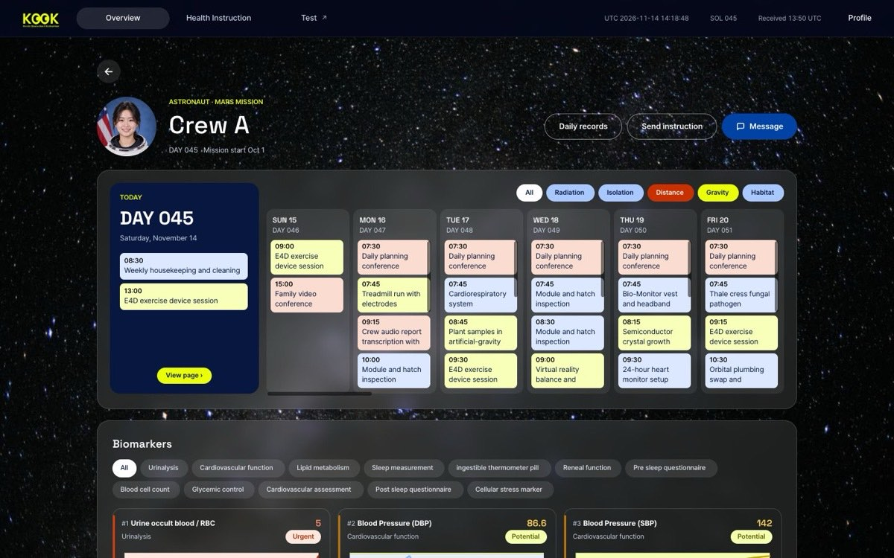<br><b>Doctor · Crew profile</b><br>All of a crew member's biomarkers with graphs, to anticipate their health and give advice.</td>
<td width="50%" valign="top">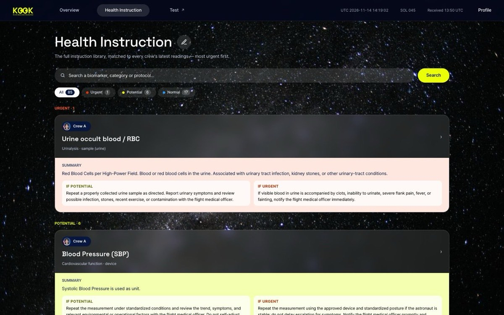<br><b>Doctor · Health instruction</b><br>The doctor updates biomarker guidance and instructions directly to match the crew's current state.</td>
</tr>
</table>

## Why it matters

By helping astronauts understand their health and take the right action on their own, KOOK lets them play a more active role in managing their well-being on long-duration missions. Astronauts in any field can easily monitor and manage their health.

## Expectations

1. **Faster response to hazards.** Astronauts act on doctor-approved guidance the moment a risk appears, without waiting for a delayed reply from Earth.
2. **Built for longer missions.** As missions go farther, guidance from Earth takes longer to arrive. KOOK helps astronauts take care of themselves.
3. **Easy for non-experts.** Simple steps and voice guidance help astronauts understand their own health, even without professional medical training.
4. **Plan with the calendar.** Tasks are sorted by the five hazards, so astronauts can see the week's risks and prepare early.

## Considered values

We believe technology should not make health management more complicated. It should make it easier for people to understand their condition and know what to do next. Throughout the development of KOOK, we focused on three values:

- **Accessibility.** Health information should be understandable even without medical expertise.
- **Real time.** Health data is continuously monitored and updated, so astronauts and medical professionals on Earth stay informed about changes in the astronaut's health and can communicate about them.
- **Expert advice.** Wherever astronauts are in space, they can consult medical professionals on Earth directly.

## What we used

| Area | Tools |
| --- | --- |
| Planning | Notion, Google Docs, draw.io |
| Data collection and analysis | Claude, ChatGPT |
| Design | Figma |
| Development | JavaScript, HTML, CSS |

## Team

Our team's greatest strength is the way we bring together different perspectives and skills. With backgrounds in biology, programming and design, each of us approaches problems differently, but we share the same goal: making space health management more accessible and practical for astronauts.

**Sooyeon Cho** — Development

- Developed the KOOK dashboard with Claude (an AI coding assistant), turning the team's Figma designs into a working web app.
- Created the dummy crew data: a month of readings for four crew members, each with a different mix of Normal, Potential and Urgent biomarkers.
- Designed the data compression for the Mars–Earth link and measured it. Readings are buffered on Mars and sent when a biomarker newly turns Potential or Urgent, or every 6 hours. Each file is packed as columns + deltas and compressed with zstd, which brings a day of data to about 4% of its raw size.

📎 [Development](docs/DEVELOPMENT.md)

**Haejun Paik** — Design

- Established the project's brand identity and visual guidelines, including the logo, typography, icons and other visual elements.
- Designed the user interface to make the health-monitoring experience intuitive and accessible for astronauts.
- Created the final presentation deck to communicate the project's concept, key features and design solutions.

📎 [Design](docs/DESIGN.md)

**Dahyun Lee** — Biology

- Researched astronaut health and identified key physiological and cognitive biomarkers, considering the unique conditions of space missions.
- Organized the biomarkers into categories and set reference ranges and risk thresholds that classify health conditions into steps.
- Turned the biological data into practical health-monitoring features, including personalized recommendations and action guidelines for astronauts.

📎 [Data README](data/README.md)

## Repository

| Folder | What's inside |
| --- | --- |
| [`dashboard/`](dashboard/) | The KOOK dashboard (crew and ground doctor views). See [`dashboard/README.md`](dashboard/README.md) |
| [`test/`](test/) | Test bench: replays a crew's day as Raw → Astronaut dashboard → Doctor dashboard |
| [`data/`](data/) | Crew readings (`crew/{A,B,C,D}_raw.csv`), biomarker rules, health instructions, event calendar |
| [`docs/`](docs/) | [Development](docs/DEVELOPMENT.md): architecture, status rules, data flow from Mars to Earth, design history |
| [`tools/`](tools/) | Scripts behind the size measurements |
| [`assets/`](assets/) | Logos, profile photos, backgrounds, diagrams |

**Run locally:** serve the repository root, then open http://localhost:8765/dashboard/

```bash
python3 -m http.server 8765
```
