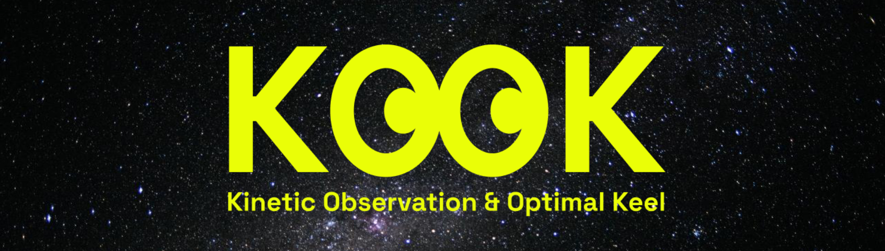

  

[구글 슬라이드](https://docs.google.com/presentation/d/1-_GjA7EkPju9ftL7wJygjFODrgVq4lCvm-AXgDYFebA/edit?slide=id.p#slide=id.p)
- [ ] Project Summary(50-200 단어)
- [ ] Project Links(ppt, 깃허브)
- [ ] Project Details 
- [ ] Use of AI 
- [ ] Nasa Data + Other Data Resources 밝히기

## Compressed transmission

How crew health data travels from Mars to Earth in the dashboard. The **Conversation** page shows the live log of what was sent; this section explains how it works. Code: [`dashboard/app.js`](dashboard/app.js) (`transmissionLog`, `ccsdsPacketize`, `ccsdsUnpack`).

**Link:** Mars → Earth, 20 min one-way light delay. Every entry is stamped *Sent* (Mars) and *Earth* (sent + 20 min) and shows *In transit* until it arrives.

**Two lanes, split by each reading's status** (biomarker rules in `data/biomarker/biomarker.csv`):

| Lane | Readings | When | Encoding |
| --- | --- | --- | --- |
| **Cold data** | Normal | Hourly batch, sent on the hour | CSV → zstd (level 19) → CCSDS Space Packets |
| **Hot data** | Potential / Urgent | Every minute, as they happen | CSV → zstd (level 19) |

Normal readings can wait, so they are buffered for an hour and sent together. Potential and Urgent readings go out right away so the ground doctor sees them as soon as the light delay allows.

**zstd:** real Zstandard compression in the browser via WebAssembly ([`@bokuweb/zstd-wasm`](https://www.npmjs.com/package/@bokuweb/zstd-wasm)), level 19. The payload is a small CSV: `date,time,biomarker,figure`.

**CCSDS Space Packet** (CCSDS 133.0-B), used for the cold lane:

- **Primary header (6 bytes):** version 0, telemetry, secondary header present, APID per crew (A `0x101`, B `0x102`, C `0x103`, D `0x104`), sequence flags, 14-bit sequence count, data length.
- **Secondary header (6 bytes):** CUC time, 4 bytes of seconds since the mission epoch (2026-10-01) plus 2 bytes of fine time.
- **User data:** up to 1018 bytes of the zstd stream per packet, so each packet is at most 1032 bytes. Larger batches are split, and the sequence flags mark the first, middle and last packets.
- **Error control (2 bytes):** CRC-16/CCITT-FALSE over the whole packet.

**Ground-side check:** every batch is decoded right after it is built. The packets are reassembled, every CRC is checked, the stream is decompressed and compared byte for byte with the original CSV. The log shows `✓ verified` when all of that matches.

**What the ground doctor sees:** the doctor's screens use only readings that have reached Earth on this schedule. The astronaut's screens show everything measured so far.

- Potential and Urgent readings appear about 21 minutes after they are measured (a 1-minute bundle plus 20 minutes of light time).
- Normal readings arrive in hourly batches, 20 minutes after each hour ends. A 10:05 reading, for example, shows up at 11:20.

So at the same moment the two screens can show different latest values, and the doctor's top bar shows when data last arrived (`Received HH:MM UTC`). Chat messages are not delayed, so the demo conversation stays usable.

**Log entry:** file name, number of readings, raw size → size on the wire, number of packets (cold only), verification, and send/arrival times.

**Note:** a hot bundle usually holds a single reading (readings come every 5 minutes), so zstd's frame overhead can make it a few bytes larger than the raw CSV. The gain shows up in the hourly cold batches.
