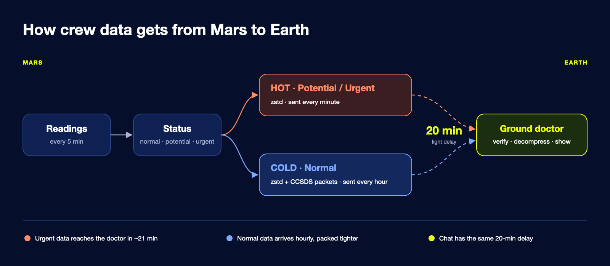

  

[구글 슬라이드](https://docs.google.com/presentation/d/1-_GjA7EkPju9ftL7wJygjFODrgVq4lCvm-AXgDYFebA/edit?slide=id.p#slide=id.p)
- [ ] Project Summary(50-200 단어)
- [ ] Project Links(ppt, 깃허브)
- [ ] Project Details 
- [ ] Use of AI 
- [ ] Nasa Data + Other Data Resources 밝히기

## Compressed transmission

How crew health data travels from Mars to Earth in the dashboard. The **Conversation** page shows the live log of what was sent; this section explains how it works. Code: [`dashboard/app.js`](dashboard/app.js) (`transmissionLog`, `ccsdsPacketize`, `ccsdsUnpack`).

**Link:** Mars → Earth, 20 min one-way light delay. Every entry is stamped *Sent* (Mars) and *Earth* (sent + 20 min) and shows *In transit* until it arrives.

**Two lanes, split by each reading's status** (biomarker rules in `data/biomarker/biomarker.csv`):

| Lane | Readings | When | Encoding |
| --- | --- | --- | --- |
| **Cold data** | Normal | Hourly batch, sent on the hour | CSV → zstd (level 19) → CCSDS Space Packets |
| **Hot data** | Potential / Urgent | Every minute, as they happen | CSV → zstd (level 19) |

Normal readings can wait, so they are buffered for an hour and sent together. Potential and Urgent readings go out right away so the ground doctor sees them as soon as the light delay allows.

**zstd:** real Zstandard compression in the browser via WebAssembly ([`@bokuweb/zstd-wasm`](https://www.npmjs.com/package/@bokuweb/zstd-wasm)), level 19. The payload is a small CSV: `date,time,biomarker,figure`.

**CCSDS Space Packet** (CCSDS 133.0-B), used for the cold lane:

- **Primary header (6 bytes):** version 0, telemetry, secondary header present, APID per crew (A `0x101`, B `0x102`, C `0x103`, D `0x104`), sequence flags, 14-bit sequence count, data length.
- **Secondary header (6 bytes):** CUC time, 4 bytes of seconds since the mission epoch (2026-10-01) plus 2 bytes of fine time.
- **User data:** up to 1018 bytes of the zstd stream per packet, so each packet is at most 1032 bytes. Larger batches are split, and the sequence flags mark the first, middle and last packets.
- **Error control (2 bytes):** CRC-16/CCITT-FALSE over the whole packet.

**Ground-side check:** every batch is decoded right after it is built. The packets are reassembled, every CRC is checked, the stream is decompressed and compared byte for byte with the original CSV. The log shows `✓ verified` when all of that matches.

**What the ground doctor sees:** the doctor's screens use only readings that have reached Earth on this schedule. The astronaut's screens show everything measured so far.

- Potential and Urgent readings appear about 21 minutes after they are measured (a 1-minute bundle plus 20 minutes of light time).
- Normal readings arrive in hourly batches, 20 minutes after each hour ends. A 10:05 reading, for example, shows up at 11:20.

So at the same moment the two screens can show different latest values, and the doctor's top bar shows when data last arrived (`Received HH:MM UTC`). Chat follows the same 20-minute light delay: the sender sees a message right away as *In transit*, which turns into *Delivered* when it arrives. The other side sees it only when it arrives.

**Log entry:** file name, number of readings, raw size → size on the wire, number of packets (cold only), verification, and send/arrival times.

**Note:** a hot bundle usually holds a single reading (readings come every 5 minutes), so zstd's frame overhead can make it a few bytes larger than the raw CSV. The gain shows up in the hourly cold batches.

### Size experiments: what we tried

All numbers are for one 24-hour day (2026-11-13) of crew data, measured with real zstd (level 19). Status rules come from `data/biomarker/biomarker.csv`. The scripts live outside the repo; the method is described here so the numbers can be redone.

**1. Four ways to send the same day (Crew A: 1,168 readings, 322 of them Potential/Urgent)**

| Method | Size | vs raw |
| --- | ---: | ---: |
| 1. Raw CSV | 45.6 KB | 100% |
| 2. Whole day, zstd | **3.5 KB** | **7.7%** |
| 3. Whole day, CCSDS packets (no compression, 46 packets) | 46.2 KB | 101.4% |
| 4. Split, as the dashboard does | 29.3 KB | 64.2% |
| └ hot: Potential/Urgent, 1-minute zstd bundles (288) | 22.9 KB | 50.2% |
| └ cold: Normal, hourly zstd + CCSDS (24 batches) | 6.4 KB | 14.1% |
| (reference) whole day, zstd + CCSDS | 3.6 KB | 7.9% |

Crews B, C and D have almost no Potential/Urgent readings. For them method 4 comes to 7.7–8.0 KB (about 17%), against 3.7–4.0 KB for method 2.

- **CCSDS is packaging, not compression.** Each packet adds 14 bytes (6 B primary header, 6 B time, 2 B CRC), so the size grows by about 1.4%.
- **Compressing a whole day at once is the smallest**, because dates, biomarker names and the CSV header repeat thousands of times and zstd stores each only once.
- **Splitting costs bytes but buys time.** An Urgent reading reaches the doctor in about 21 minutes instead of after the day ends.

**2. Why the hot lane is so big: 22.9 KB from 21.4 KB of raw rows**

A 1-minute hot bundle almost always holds a single reading, because readings come every 5 minutes. Each bundle contains:

| Part | Size |
| --- | ---: |
| CSV header `date,time,biomarker,figure` | 27 B |
| One row, e.g. `2026-11-13,12:05,Blood Pressure (SBP),142.1` | ~45 B |
| zstd frame overhead added to every bundle | ~9–13 B |

A single row gives zstd nothing earlier to refer back to, so the ~72 B bundle grows to ~80 B. Crew A's SBP is Potential all day, so there are 288 such bundles.

**3. A mistake we made with the test bench, and the correction**

The test bench's size table first showed "priority: 1.5% of raw". That looked like proof that sending anomalies every second compresses far better than 1-minute bundles. It doesn't. The figure came from compressing *all* anomaly rows so far in one go.

The files the simulator actually sent (`A_priority.bin`) were 127–155 B each, larger than the rows inside them. Sending every second only helps when several anomalies pile up within that second. That happens in the fast replay, but not in real time, where readings are 5 minutes apart. The test bench now shows both: "If compressed in one go (reference)" and "Files actually sent so far".

**4. What actually shrinks small bundles** (Crew A, 288 hot bundles, raw with header 21.9 KB)

| Option | Total | vs raw | Per bundle |
| --- | ---: | ---: | ---: |
| a) header + rows, zstd (dashboard today) | 23.4 KB | 107% | 81 B |
| b) rows only, no compression | 14.1 KB | 64% | 49 B |
| c) rows only, zstd | 15.8 KB | 72% | 55 B |
| d) rows only, zstd with a shared dictionary | 9.4 KB | 43% | 33 B |
| d2) same, with zstd frame header fields trimmed | 8.2 KB | 38% | 29 B |
| (whole day of hot rows at once, for reference) | 0.7 KB | 3% | 2 B |

For d, the 2 KB dictionary was trained on Nov 1–12 readings. Both Mars and Earth would hold it before the mission.

A shared dictionary gives zstd the repeated parts (dates, biomarker names, number formats) before the first bundle, so even a one-row bundle compresses. It keeps the 21-minute delivery and cuts the hot lane by almost two-thirds. The dashboard still uses option a; switching to d is the next step if we want it.

**Test bench:** [`test/`](test/) runs the ear-worn device and the compression simulator on our data, so these effects can be watched live. See [`test/README.md`](test/README.md).
