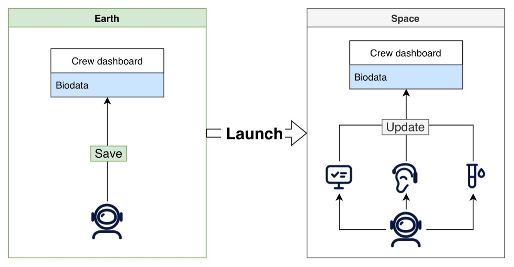
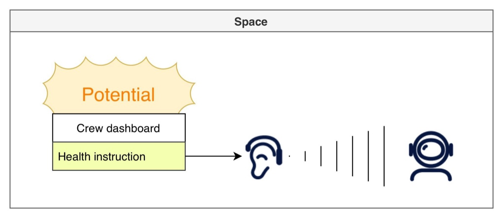
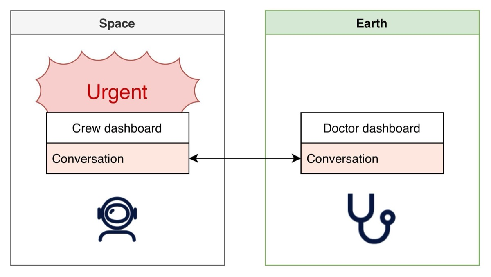
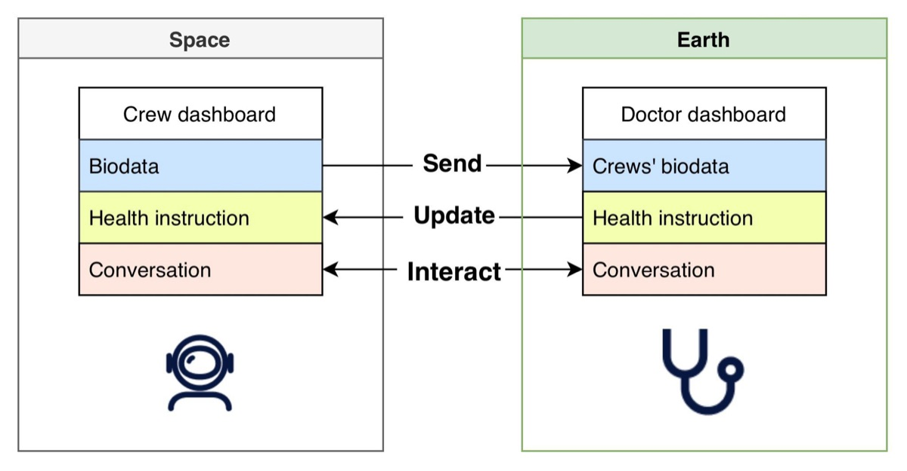

<p align="center">
  
</p>

# KOOK — Kinetic Observation & Optimal Keel

**A health monitoring dashboard that helps astronauts manage their own health on long-duration space missions.**

NASA Space Apps Challenge · *Create Health Monitoring Software for Astronauts on Space Missions*
Team Kook · Sooyeon Cho, Haejun Paik, Dahyun Lee

[Live dashboard](https://chosooy.github.io/nasa-hackathon/dashboard/) · [Test bench](https://chosooy.github.io/nasa-hackathon/test/) · [Slides](https://docs.google.com/presentation/d/1-_GjA7EkPju9ftL7wJygjFODrgVq4lCvm-AXgDYFebA/edit?slide=id.p#slide=id.p) · [Data flow](docs/data-flow.md)

## Summary

KOOK (Kinetic Observation & Optimal Keel) is a health monitoring dashboard designed to help astronauts manage their health on their own during long-duration space missions.

On long missions, astronauts are exposed to the five major health hazards identified by NASA. These risks vary in severity, so astronauts need a system that lets them assess their health immediately and gives them step-by-step guidance.

KOOK aims to lower the barriers to health management in space with an intuitive, accessible dashboard that anyone can understand and use.

## Background

> *How can astronauts on space missions monitor and improve their health in real time?*

| Problem | Our answer |
| --- | --- |
| Crews face five major health hazards that vary in severity | **Phased diagnosis:** the response follows the severity, Potential or Urgent |
| Crews lack the medical expertise to judge dangerous risks | **Earth–space interaction:** guidance and conversation come from doctors on Earth |
| Health guidance comes with complex interfaces | **A well-organized, interactive interface** that anyone can read |

## Biodata classification

We classified **85 biomarkers** by NASA's five major hazards:

- Space radiation
- Isolation and confinement
- Distance from Earth
- Gravity fields
- Hostile and closed environments

Each biomarker is described with:

- its data-gathering method (device, sample or computer test) and category
- a short explanation
- its measurement period (minimum, maximum or a specific period)
- Normal / Potential / Urgent thresholds
- instructions to follow when it is Potential or Urgent

The demo dashboard uses 32 of these biomarkers for four crew members (`data/crew/`).

## How it works

### Gathering biodata



Before launch, each crew member records an individual **baseline** of their health on Earth. After launch, KOOK compares that baseline with the biodata gathered in space from **computer tests, devices and samples**. These values are used to assess each crew member's health.

### Phased diagnosis

KOOK sorts each biomarker into one of three severity levels: **Urgent**, **Potential** or **Normal**. Crews and the ground doctor go through diagnosis in phases, in both directions.

**Step 1 — Immediate response** (Potential)



- Astronauts open the **Health Instruction Library**. Its health guidelines and responses are uploaded and updated by medical professionals.
- A **linked audio device** reads the instructions aloud, so astronauts can follow the recommended steps without relying only on the screen.

**Step 2 — In-depth consultation** (Urgent, or whenever more help is needed)



- Astronauts talk directly with medical professionals on Earth in **one-on-one chat consultations**.
- They can report a serious health problem and get out of the hazard quickly.

### Earth–space interaction



| Crew dashboard (space) | | Doctor dashboard (Earth) |
| --- | :---: | --- |
| Biodata | **Send →** | Crews' biodata |
| Health instruction | **← Update** | Health instruction |
| Conversation | **← Interact →** | Conversation |

**Getting the data to Earth**

- The crew dashboard shows every reading right away.
- Readings go to the doctor's dashboard as small compressed files. A new Potential or Urgent reading is sent at once, and everything else at least every 6 hours.
- Each file arrives 20 minutes later, the one-way light delay. Chat has the same delay.
- See [Data flow](docs/data-flow.md) for the details and the experiments behind it.


## Screens

**Crew (space)**

- **Onboarding.** Crew members choose their profile and location, then download and upload the baseline measured on Earth.
- **Main page.** Today's schedule and upcoming events. Each event is tagged with the space hazard it relates to.
- **Health instruction.** Biomarkers in Urgent → Potential → Normal order, each with what to do.
- **Biomarker detail.** Summary, past records, what to do now, measurement period, and the Earth–space comparison.
- **Conversation.** One-on-one chat with the ground doctor, where serious health problems can be reported.

**Ground doctor (Earth)**

- **Main page.** The status of every crew member at a glance on one screen.
- **Health instruction.** The doctor updates biomarker guidance and instructions directly, to match the crew's current state.
- **Crew profile.** Click a crew member to see all their biomarkers. The graphs help anticipate their health and give advice.
- **Conversation.** One-on-one chat with each crew member.

## Why it matters

By helping astronauts understand their health and take the right action on their own, KOOK lets them play a more active role in managing their well-being on long-duration missions. Astronauts in any field can easily monitor and manage their health.

## Expectations

1. **Faster response to hazards.** Astronauts act on doctor-approved guidance the moment a risk appears, without waiting for a delayed reply from Earth.
2. **Built for longer missions.** As missions go farther, guidance from Earth takes longer to arrive. KOOK helps astronauts take care of themselves.
3. **Easy for non-experts.** Simple steps and voice guidance help astronauts understand their own health, even without professional medical training.
4. **Plan with the calendar.** Tasks are sorted by the five hazards, so astronauts can see the week's risks and prepare early.

## Considered values

We believe technology should not make health management more complicated. It should make it easier for people to understand their condition and know what to do next. Throughout the development of KOOK, we focused on three values:

- **Accessibility.** Health information should be understandable even without medical expertise.
- **Real time.** Health data is continuously monitored and updated, so astronauts and medical professionals on Earth stay informed about changes in the astronaut's health and can communicate about them.
- **Expert advice.** Wherever astronauts are in space, they can consult medical professionals on Earth directly.

## What we used

| Area | Tools |
| --- | --- |
| Planning | Notion, Google Docs, draw.io |
| Data collection and analysis | Claude, ChatGPT |
| Design | Figma |
| Development | JavaScript, HTML, CSS |

## Team

Our team's greatest strength is the way we bring together different perspectives and skills. With backgrounds in biology, programming and design, each of us approaches problems differently, but we share the same goal: making space health management more accessible and practical for astronauts.

<!-- Roles: fill in from what each teammate wrote. -->
| Name | Background | Role in KOOK |
| --- | --- | --- |
| Sooyeon Cho | | |
| Haejun Paik | | |
| Dahyun Lee | | |

## Repository

| Folder | What's inside |
| --- | --- |
| [`dashboard/`](dashboard/) | The KOOK dashboard (crew and ground doctor views). See [`dashboard/README.md`](dashboard/README.md) |
| [`test/`](test/) | Test bench: replays a crew's day as Raw → Astronaut dashboard → Doctor dashboard |
| [`data/`](data/) | Crew readings (`crew/{A,B,C,D}_raw.csv`), biomarker rules, health instructions, event calendar |
| [`docs/`](docs/) | [Data flow](docs/data-flow.md): how data moves from Mars to Earth, and the design history |
| [`tools/`](tools/) | Scripts behind the size measurements |
| [`assets/`](assets/) | Logos, profile photos, backgrounds, diagrams |

**Run locally:** serve the repository root, then open http://localhost:8765/dashboard/

```bash
python3 -m http.server 8765
```
