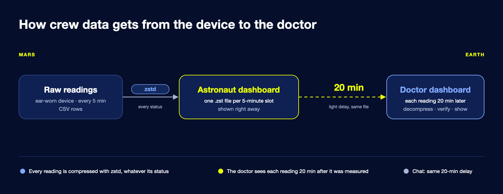

<!-- KOOK development document: how the dashboard works, how data moves from Mars to Earth, and why it is built this way. Linked from the README and the dashboard's "How it works". -->
[← Back to README](../README.md)

# KOOK development document

How KOOK works inside: the parts, the data it reads, how a reading becomes Normal, Potential or Urgent, how data travels from Mars to Earth, and the experiments behind those choices.

**Contents**

- [Architecture](#architecture)
- [Running it](#running-it)
- [Data](#data)
- [Status rules](#status-rules)
- [How the dashboard works](#how-the-dashboard-works)
- [Data flow](#data-flow)
- [Packed file format](#packed-file-format)
- [Test bench and tools](#test-bench-and-tools)
- [Design history](#design-history)

## Architecture

KOOK is a static web app: plain HTML, CSS and JavaScript with no build step and no server code. Everything runs in the browser and reads CSV files from the repository.

```
data/*.csv ──fetch──▶ dashboard/app.js ──▶ crew view (#/crew, Mars)
                         │                    every reading right away
                         │
                         └─ sendSchedule ──▶ doctor view (#/doctor, Earth)
                            buffer → zstd       only files that have arrived (+20 min)
```

| Part | Files | Role |
| --- | --- | --- |
| Dashboard | [`dashboard/`](../dashboard/) (`index.html`, `app.js`, `styles.css`) | The app itself: astronaut and ground doctor screens in one page |
| Test bench | [`test/`](../test/) | Replays one crew's day as Raw → Astronaut dashboard → Doctor dashboard |
| Data | [`data/`](../data/) | Crew readings, biomarker rules, health instructions, event calendar |
| Tools | [`tools/`](../tools/) | Python scripts that generated the demo data and measured compression. Not used at runtime |
| Assets | [`assets/`](../assets/) | Logos, profile photos, backgrounds, diagrams |

External libraries, all loaded from a CDN:

- [`@bokuweb/zstd-wasm`](https://www.npmjs.com/package/@bokuweb/zstd-wasm) 0.0.22: real Zstandard compression in the browser (WebAssembly)
- Fonts: Space Grotesk (Google Fonts) and Pretendard

## Running it

Serve the **repository root** over HTTP, because the pages read `../data` and `../assets`:

```bash
python3 -m http.server 8765
```

- Dashboard: http://localhost:8765/dashboard/
- Test bench: http://localhost:8765/test/

GitHub Pages serves `main` at https://chosooy.github.io/nasa-hackathon/. Opening `index.html` as a file does not work, because the browser blocks `fetch` on `file://`.

## Data

| File | Columns | Used for |
| --- | --- | --- |
| `data/crew/{A,B,C,D}_raw.csv` | `date,time,biomarker,figure` | Readings for Nov 1–30, 2026, mostly every 5 minutes |
| `data/biomarker/biomarker.csv` | `biomarker, category, summary, method, period, baseline, hazard, yellow, red, …, unit` | Status thresholds (`yellow`, `red`), units. Its row order also gives each biomarker its id in packed files |
| `data/health_instruction/health_instruction.csv` | `biomarker, category, summary, method, period, baseline, hazard, yellow_instruction, red_instruction, unit` | Summaries, the hazards each biomarker belongs to, and what to do for Potential (`yellow_instruction`) and Urgent (`red_instruction`) |
| `data/biomarker/raw biomarker.csv` | every column from the research | Detail page: Earth vs space comparison, measurement criteria and timing |
| `data/calendar/events.csv` | `event_id,date,start_time,end_time,duration_min,crew,category,title,hazard` | Crew schedules and the hazard tag on each event |

See [`data/README.md`](../data/README.md) for how the biomarker data was put together.

On load, `app.js` fetches every file, parses it with a small CSV parser (`parseCSV`) and builds one in-memory model (`buildModel` → `DB`):

- `DB.rules[biomarker]`: parsed `yellow` / `red` thresholds and unit
- `DB.info[biomarker]`: summary, hazards and instructions
- `DB.crews[A–D]`: each crew's readings as a time-sorted series per biomarker, plus daily mean/min/max for continuous biomarkers (more than 200 readings) and the send schedule (`files`)

## Status rules

Every reading gets one of three statuses from `biomarker.csv` (`statusOf`):

| Status | Rule |
| --- | --- |
| **Urgent** | The value matches the `red` column |
| **Potential** | Otherwise, the value is outside the `yellow` column (the normal range) |
| **Normal** | Otherwise |

- Thresholds are written as text such as `<120 mmHg`, `36.1–37.2 °C` or `<40 OR >120 beats/min`. `parseRule` turns them into comparisons. Rules relative to the astronaut's own baseline (`B-2SD`) are skipped for now.
- A biomarker's current status is its **latest reading** at the dashboard clock (`valueAt`).
- **Hazard board.** Each biomarker belongs to one or more of NASA's five hazards (Radiation, Isolation, Distance, Gravity, Habitat) through the `hazard` column. A hazard takes the worst status among its Potential/Urgent biomarkers (`hazardStatus`).
- **Instructions.** Potential shows `yellow_instruction`, Urgent shows `red_instruction` (`instructionFor`).

## How the dashboard works

**One page, hash routes.** `index.html` holds an empty `#app`. `render()` reads `location.hash` and writes the whole screen as an HTML string:

| Route | Screen |
| --- | --- |
| `#/` | Landing |
| `#/select` | Onboarding: choose crew member and location |
| `#/crew` · `/day/<date>` · `/instructions` · `/bio/<name>` · `/chat` · `/profile` | Astronaut screens |
| `#/doctor` · `/crew/<A–D>` · `/instructions` · `/attention` · `/bio/<name>` · `/chat` · `/profile` | Ground doctor screens |

**The clock.** The data covers Nov 1–30, 2026. The dashboard folds real time into that window (`simNow`), so "now" moves forward at real speed and loops back to Nov 1 after Nov 30. A timer runs every second to update clocks, deliver chat messages and files, and roll over to the next day.

**Two views of the same data.** The astronaut and the doctor see different data on purpose:

- **Astronaut (Mars), `DB.view = 'live'`:** every reading up to now.
- **Doctor (Earth), `DB.view = 'earth'`:** only readings whose file has already arrived (`earthCrew`). It is rebuilt once per simulated minute, and the doctor's screen re-renders when a new file lands.

`withCrew(c, fn)` switches the current crew, so the same page functions draw any crew's data.

**Charts** are hand-written SVG strings (`zoneChart`, `areaChart`, `donutSvg`) with Normal / Potential / Urgent bands drawn behind the line.

**Saved in the browser.** Chat, doctor edits to instructions and library additions are saved in `localStorage` (keys start with `kook.`). For the demo both roles share it in the same browser.

## Data flow



Crew health data goes through three stages:

| Stage | Where | What happens | When |
| --- | --- | --- | --- |
| **Raw** | Ear-worn device | Readings as CSV rows (`date,time,biomarker,figure`), every 5 minutes | As measured |
| **Astronaut dashboard** | Mars | Shows every reading right away and keeps it in a buffer | Right away |
| **Doctor dashboard** | Earth | Receives the buffer as one zstd file | 20 minutes after it is sent (one-way light time) |

**When the buffer is sent.** Whichever of these comes first:

- **A biomarker newly turns Potential or Urgent.** Its status changes into Potential or Urgent, or from Potential to Urgent. A biomarker that stays Potential does not trigger again, so a crew whose blood pressure is Potential all day doesn't send every 5 minutes.
- **The buffer is 6 hours old.** Normal data never waits longer than 6 hours.

That means a new problem reaches the doctor 20 minutes after it is measured, and everything else arrives in larger files that compress much better.

- **Packing + zstd.** Before compression the buffer is packed as **columns + deltas** (option f in [Shrinking further](#shrinking-further-under-the-same-rule); byte layout in [Packed file format](#packed-file-format)).
  - Readings are grouped by biomarker. The id comes from the row order of `data/biomarker/biomarker.csv`, which both sides hold.
  - Each time and value is stored as the change from the previous one, as small whole numbers.
  - Then real Zstandard compression (level 19) runs in the browser via WebAssembly ([`@bokuweb/zstd-wasm`](https://www.npmjs.com/package/@bokuweb/zstd-wasm)), called from JavaScript.
  - Each file is decompressed and unpacked again and must give back the same readings (`✓ verified`).
- **File names.** `A_2026-11-14T1300.zst` is Crew A's buffer, sent at 13:00 UTC on Nov 14.
- **Doctor dashboard.** It uses only readings whose file has arrived, and its top bar shows the last arrival (`Received HH:MM UTC`). The astronaut's and the doctor's latest values can differ by up to 6 hours for Normal data.
- **Chat** has the same 20-minute delay. The sender sees *In transit*, then *Delivered*; the other side sees a message only on arrival.
- **Where to see it**
  - The astronaut's **Conversation** page shows the files sent today, with the trigger (new Potential/Urgent or 6-hour send), readings, raw → zstd size, check, and doctor arrival. It also shows what is waiting in the buffer.
  - The [test bench](../test/) replays a whole day as **Raw | Astronaut dashboard | Doctor dashboard**.
- **Code:** [`dashboard/app.js`](../dashboard/app.js) (`sendSchedule`, `transmissionLog`, `earthCrew`) and [`test/app.js`](../test/app.js).
- **Data:** `data/crew/{A,B,C,D}_raw.csv`.

**Size for one day** (2026-11-13, 1,168 readings per crew, buffer starting empty at 00:00):

| Crew | Raw CSV | Files sent | Sent (columns + zstd) | Longest wait for Normal data |
| --- | ---: | ---: | ---: | ---: |
| A (blood pressure turns Potential often) | 45.5 KB | 17 | 1.8 KB (4.1%) | 6 h |
| B | 45.5 KB | 5 | 1.7 KB (3.6%) | 6 h |
| C | 45.5 KB | 5 | 1.6 KB (3.6%) | 6 h |
| D (all Normal) | 45.5 KB | 4 | 1.6 KB (3.6%) | 6 h |

For comparison, sending every 5-minute slot as its own CSV + zstd file kept the doctor exactly 20 minutes behind on everything, but came to about 64% of raw (see Design history).

### The trade-off

This flow does **not** give the smallest possible size. zstd shrinks data better the more it gets at once, because repeated dates and biomarker names are stored only once. So the longer Mars waits, the smaller the data, and the later the doctor sees it:

| How often Mars sends (Nov 13, ~45.5 KB raw per crew, CSV rows + zstd) | Size vs raw | When the doctor sees it |
| --- | ---: | --- |
| Every 5-minute slot | ~64% | Always 20 min after measurement |
| **New Potential/Urgent, or every 6 h (current)** | 9.8–12.1% | New problems after 20 min; Normal data within 6 h |
| A whole day in one file | 7.8–8.6% | Up to a day later |

We chose the middle row on purpose. It costs only 2–4 percentage points more than sending once a day, and in return a new problem reaches the doctor in 20 minutes instead of the next day.

### Shrinking further under the same rule

Same send rule, same files, packed differently. Every option is decoded again and must give back the same readings. Measured on 2026-11-13 by [`tools/compression_options.py`](../tools/compression_options.py) (dictionaries trained on Nov 1–12 files made by the same rule):

| Option | A | B | C | D |
| --- | ---: | ---: | ---: | ---: |
| a) CSV rows, zstd 19 (**current**) | 12.1% | 10.1% | 9.8% | 9.8% |
| b) CSV rows, zstd 22 (highest level) | 12.1% | 10.1% | 9.8% | 9.8% |
| c) CSV rows, zstd + shared dictionary | 9.5% | 9.2% | 8.9% | 9.1% |
| d) compact text, zstd | 8.5% | 7.9% | 7.6% | 7.7% |
| e) compact text, zstd + dictionary | 7.7% | 7.6% | 7.3% | 7.6% |
| **f) columns + deltas, zstd** | **4.1%** | **3.6%** | **3.6%** | **3.6%** |
| g) columns + deltas, no zstd | 5.7% | 5.5% | 5.5% | 5.4% |
| h) columns + deltas, zstd + dictionary | 3.6% | 3.3% | 3.2% | 3.2% |

What the options mean:

- **compact text:** the date is written once per file, time as `HHMM`, and the biomarker as a number from a list both sides already hold, e.g. `1305,4,142.1`.
- **columns + deltas:** readings are grouped by biomarker. For each one we store the slot number and the value as whole numbers, with decimals fixed per biomarker, e.g. 142.1 → 1421. Each number is stored as the change from the previous one, in a variable number of bytes. Readings that barely change become runs of tiny numbers, which zstd squeezes very well.

What we learned:

- Raising zstd from level 19 to 22 changes nothing on files this small.
- A shared dictionary helps plain CSV (~2 points) but adds little once the format is already compact (f → h: ~0.4 points), and both sides must keep the same dictionary file.
- **The format matters more than the compressor.** Option f takes a day to 3.6–4.1% of raw. That is about a third of the current size, and smaller than a whole day of CSV in one file (7.8%), while keeping the same 20-minute alerts.
- The values come back exactly, but number formatting does not: `142.0` comes back as `142`.

**Applied: option f.** The dashboard and the test bench now pack every file as columns + deltas before zstd (`packReadings` and `unpackReadings` in [`dashboard/app.js`](../dashboard/app.js) and [`test/app.js`](../test/app.js)). On the dashboard, Crew A's 13:00 file on Nov 14 went from 772 B (CSV + zstd) to 264 B, from 8.1 KB of CSV.

## Packed file format

Each file sent to Earth is the buffer packed as **columns + deltas** (`packReadings`), then compressed with zstd level 19. Both sides hold `biomarker.csv`, so a biomarker travels as its row number, not its name.

```
varint  day        days since 2026-01-01 of the file's first reading
varint  groups     number of biomarkers in the file
per biomarker:
  varint  id         row number in biomarker.csv
  byte    decimals   e.g. 1 → 142.1 is stored as 1421
  varint  count
  count × (varint Δminutes, varint zigzag(Δvalue))
```

- Minutes count from 00:00 of `day`, so a file can cross midnight.
- Every time and value is the **change from the previous one**. Readings that barely move become runs of tiny numbers, which zstd squeezes very well.
- `varint` uses 7 bits per byte. `zigzag` maps negative changes to small positive numbers.
- After compressing, the file is decompressed and unpacked again (`unpackReadings`) and must give back the same readings (`sameReadings`). The dashboard shows `✓ verified` for it.

## Test bench and tools

- **[Test bench](../test/)** ([`test/app.js`](../test/app.js)) replays one crew's day through the same rules: the send schedule, packing, zstd and the 20-minute delay. It also reads each new Potential/Urgent instruction aloud. See [`test/README.md`](../test/README.md).
- **[Tools](../tools/)** are the Python scripts that generated Crews B–D and measured every option in this document. See [`tools/README.md`](../tools/README.md).

## Design history

**Step 2, one zstd file per 5-minute slot.** Every slot, whatever its status, went to the doctor 20 minutes after it was measured. It was simple, but each file held only about four readings, so a day came to ~29 KB (64% of raw). We also considered sending on any Potential/Urgent reading, else once a day: that cut Crews B–D to ~9%, but Crew A's blood pressure is Potential all day, so it still sent every 5 minutes (64%). Counting only *new* Potential/Urgent readings and adding the 6-hour cap gave the current flow.

**Step 1, hot/cold lanes.** Before that, we split readings into two lanes by status:

- **hot:** Potential/Urgent readings, sent every minute
- **cold:** Normal readings, batched hourly and packed into CCSDS Space Packets

We later added a shared zstd dictionary for the hot lane. That design was replaced by step 2. These are the measurements we made along the way.

### Size experiments (hot/cold design)

All numbers are for one 24-hour day (2026-11-13) of crew data, measured with real zstd (level 19). Status rules come from `data/biomarker/biomarker.csv`. The scripts live outside the repo; the method is described here so the numbers can be redone.

**1. Four ways to send the same day (Crew A: 1,168 readings, 322 of them Potential/Urgent)**

| Method | Size | vs raw |
| --- | ---: | ---: |
| 1. Raw CSV | 45.6 KB | 100% |
| 2. Whole day, zstd | **3.5 KB** | **7.7%** |
| 3. Whole day, CCSDS packets (no compression, 46 packets) | 46.2 KB | 101.4% |
| 4. Split, as the dashboard does | 29.3 KB | 64.2% |
| └ hot: Potential/Urgent, 1-minute zstd bundles (288) | 22.9 KB | 50.2% |
| └ cold: Normal, hourly zstd + CCSDS (24 batches) | 6.4 KB | 14.1% |
| (reference) whole day, zstd + CCSDS | 3.6 KB | 7.9% |

Crews B, C and D have almost no Potential/Urgent readings. For them method 4 comes to 7.7–8.0 KB (about 17%), against 3.7–4.0 KB for method 2.

- **CCSDS is packaging, not compression.** Each packet adds 14 bytes (6 B primary header, 6 B time, 2 B CRC), so the size grows by about 1.4%.
- **Compressing a whole day at once is the smallest**, because dates, biomarker names and the CSV header repeat thousands of times and zstd stores each only once.
- **Splitting costs bytes but buys time.** An Urgent reading reaches the doctor in about 21 minutes instead of after the day ends.

**2. Why the hot lane is so big: 22.9 KB from 21.4 KB of raw rows**

A 1-minute hot bundle almost always holds a single reading, because readings come every 5 minutes. Each bundle contains:

| Part | Size |
| --- | ---: |
| CSV header `date,time,biomarker,figure` | 27 B |
| One row, e.g. `2026-11-13,12:05,Blood Pressure (SBP),142.1` | ~45 B |
| zstd frame overhead added to every bundle | ~9–13 B |

A single row gives zstd nothing earlier to refer back to, so the ~72 B bundle grows to ~80 B. Crew A's SBP is Potential all day, so there are 288 such bundles.

**3. A mistake we made with the test bench, and the correction**

The test bench's size table first showed "priority: 1.5% of raw". That looked like proof that sending anomalies every second compresses far better than 1-minute bundles. It doesn't. The figure came from compressing *all* anomaly rows so far in one go.

The files the simulator actually sent (`A_priority.bin`) were 127–155 B each, larger than the rows inside them. Sending every second only helps when several anomalies pile up within that second. That happens in the fast replay, but not in real time, where readings are 5 minutes apart. After that the test bench showed both: "If compressed in one go (reference)" and "Files actually sent so far".

**4. What actually shrinks small bundles** (Crew A, 288 hot bundles, raw with header 21.9 KB)

| Option | Total | vs raw | Per bundle |
| --- | ---: | ---: | ---: |
| a) header + rows, zstd (what the hot lane first did) | 23.4 KB | 107% | 81 B |
| b) rows only, no compression | 14.1 KB | 64% | 49 B |
| c) rows only, zstd | 15.8 KB | 72% | 55 B |
| d) rows only, zstd with a shared dictionary | 9.4 KB | 43% | 33 B |
| d2) same, with zstd frame header fields trimmed | 8.2 KB | 38% | 29 B |
| (whole day of hot rows at once, for reference) | 0.7 KB | 3% | 2 B |

For d, the 2 KB dictionary was trained on Nov 1–12 readings. Both Mars and Earth would hold it before the mission.

A shared dictionary gives zstd the repeated parts (dates, biomarker names, number formats) before the first bundle, so even a one-row bundle compresses. It keeps the 21-minute delivery and cuts the hot lane by almost two-thirds.

**Then replaced.** We used option d for a while: a 2 KB dictionary trained on Nov 1–12 data cut Crew A's 288 hot bundles from 15.8 KB to 9.6 KB.

In the end we dropped the hot/cold split, CCSDS packets and the dictionary for plain zstd: first one file per 5-minute slot (step 2), then the buffered flow in [Data flow](#data-flow).

**Test bench:** [`test/`](../test/) replays a day as Raw | Astronaut dashboard | Doctor dashboard. See [`test/README.md`](../test/README.md).
